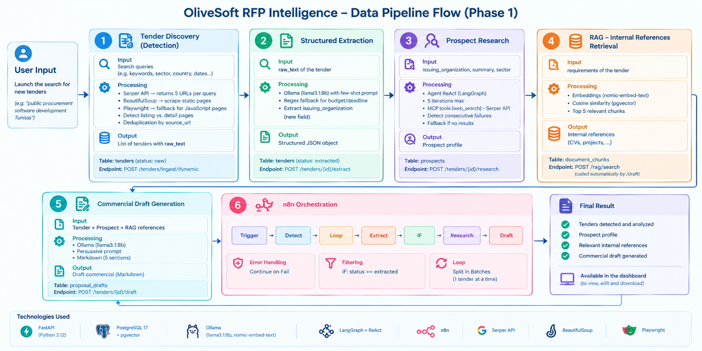

# Data Pipeline Flow: OliveSoft RFP Intelligence (Final Version)

## Overview

The OliveSoft RFP Intelligence platform is an automated pipeline that:
1. Detects tenders from several sources (open data API, web search, portals, manual input)
2. Extracts structured information with a local LLM
3. Matches every requirement against OliveSoft's internal knowledge base (RAG) and scores it
4. Qualifies each lead before it becomes a prospect
5. Researches the prospect and estimates budget and competition (ReAct agents using MCP tools)
6. Generates an evidence-bound commercial proposal (CrewAI Writer and Reviewer)
7. Lets a sales manager refine the proposal (human in the loop)
8. Exports an editable PPTX and a PDF in OliveSoft's visual identity

> **Important note:** This document describes the **final data pipeline**. It replaces the Phase 1 version, in which the draft was a single LLM call and every extracted tender automatically became a prospect. A tender now has to pass a qualification gate before any research or writing is done.

---

## Data Flow Step by Step

### Prerequisite: Knowledge Base Vectorization (pgvector)

**Before the workflow is launched**, the internal knowledge base (CVs, PFE reports, past projects) must be vectorized and stored in pgvector. This step is performed **once**, or when new documents are added, and is **not part of the workflow execution**.

- **Input**: PDF documents, either placed in `backend/data/internal_docs/` or uploaded from the web interface
- **Processing**:
  - Text extraction with `pdfplumber` (unreadable or scanned PDFs are skipped without stopping ingestion)
  - Structured metadata extraction by LLM (team size, duration, budget, client, sector, technologies)
  - Chunking (300 words with 50-word overlap)
  - Embeddings with Ollama (`nomic-embed-text`, 768 dimensions)
  - Storage in PostgreSQL with the `pgvector` extension
- **Output**: Documents with structured metadata (`documents`) and vectorized chunks (`document_chunks`)
- **Endpoints**: `POST /rag/ingest/bootstrap` (index a folder), `POST /rag/upload` (upload one PDF), `GET /rag/documents`, `DELETE /rag/documents/{id}`

---

### Step 1: Tender Detection (multi-source)
- **Input**: Search queries, a public API, configured portals or a pasted text
- **Sources**:

| Mode | Endpoint | Mechanism |
| :--- | :--- | :--- |
| Open data | `POST /tenders/ingest/opendata` | World Bank procurement notices API: structured, dated, with reference. Most reliable source. |
| Apify | `POST /tenders/ingest/apify` | Google Search Scraper and Website Content Crawler, strict notice filter, blog classifier, LLM pre-extraction |
| Serper and Playwright | `POST /tenders/ingest/dynamic` | Queries built from the technologies found in OliveSoft documents, BeautifulSoup scraping with Playwright fallback, PDF reading |
| Portals | `POST /tenders/ingest/portals` | Link discovery on configured procurement portals |
| Manual | `POST /tenders/ingest/manual` | Raw tender text submitted from the interface |

- **Processing**:
  - Noise domain filtering (social networks, job sites)
  - Pre-ranking on title and snippet, then scraping in parallel
  - Listing page detection and expansion into real detail pages
  - Notice validation: future deadline, tender reference, IT relevance, expiry check, blog and non-tender classifier
  - Deduplication on normalized `source_url`
- **Output**: Tenders stored in PostgreSQL (`new`, or `extracted` when pre-extraction is used)
- **Diagnostics**: `GET /tenders/ingest/stats`, `/ingest/apify/stats`, `/ingest/opendata/stats` explain why each candidate was accepted or rejected

### Step 2: Structured Extraction
- **Input**: Tender `raw_text`
- **Processing**:
  - Ollama (`llama3.1:8b`) with a JSON schema and a few-shot prompt, up to 3 retries on invalid JSON
  - Text focusing on relevant passages for long documents
  - Regex fallbacks for budget and deadline
  - Second dedicated LLM pass for requirements, then key-sentence mining, then derivation from title and summary
  - `is_it_software_tender` flag: out-of-scope tenders are rejected early
- **Output**: Title, issuing organization, sector, budget, deadline, requirements, summary, data quality flags
- **Table**: `tenders` (status `extracted`, or `rejected_irrelevant`)
- **Endpoint**: `POST /tenders/{id}/extract` (idempotent, `force=true` to redo)

### Step 3: Matching and Scoring (Requirements Matrix)
- **Input**: Tender `requirements`
- **Processing**:
  - For each requirement, retrieval of the top 3 chunks with their document metadata (cosine similarity in pgvector)
  - LLM judge returns `covered`, a score from 0 to 100, a justification and a concrete piece of evidence (team size, duration, budget, client)
  - A requirement is covered when the judge confirms it and the score is at least 50
  - Fallback on vector similarity if the LLM fails
- **Output**: The Requirements Matrix
- **Table**: `requirement_matches`
- **Endpoint**: `GET /tenders/{id}/matrix` (computed by `/qualify`)

### Step 4: Lead Qualification Gate
- **Input**: Requirements matrix and extracted fields
- **Processing**:
  - Score = 50% technical fit + 20% budget + 15% strategic sector + 15% deadline feasibility
  - Deadline parsing with urgency alert (3 days or fewer) and feasibility check (at least 5 days)
  - Budget check against a minimum viable budget (30,000 TND, configurable)
  - Strategic sector list (configurable in `business_rules.py`)
  - Hard rules: expired deadline, technical fit below 35, or out-of-scope tender leads to rejection
  - Qualification threshold: 55 out of 100
- **Output**: Status `qualified`, `rejected_low_score`, `rejected_expired` or `rejected_irrelevant`, with explicit reasons
- **Table**: `tenders` (scores, flags, reasons)
- **Endpoint**: `POST /tenders/{id}/qualify`, `GET /tenders/qualified/list`

### Step 5: Prospect Research
- **Input**: Issuing organization, summary, sector (qualified tenders only)
- **Processing**:
  - ReAct agent (LangGraph) with a maximum of 5 iterations
  - MCP calls: `web_search` through Serper
  - Forced first search, query reformulation, consecutive failure detection
  - Fallback output marked as incomplete if nothing is found
- **Output**: Prospect profile (company, sector, revenue, partners, past projects)
- **Table**: `prospects`
- **Endpoint**: `POST /tenders/{id}/research`

### Step 6: Budget and Competitor Insights
- **Input**: Title, sector, known budget, summary
- **Processing**: Second ReAct agent (same engine, specialized prompt) with a maximum of 4 iterations
- **Output**: Estimated budget range, confidence level, competitive positioning, likely competitors
- **Table**: `competitor_insights`
- **Endpoint**: `POST /tenders/{id}/competitor-insights`

### Step 7: Proposal Generation (CrewAI)
- **Input**: Tender, prospect, requirements matrix, competitor insights
- **Processing**:
  - Writer agent drafts six sections, Reviewer agent checks figures, evidence, tone and completeness
  - Loop capped at 3 iterations
  - The Writer may only cite figures, clients and projects present in the matrix or context
  - Deterministic anti-hallucination guard: any figure absent from the provided data is flagged and removed
  - Coverage gate: generation is refused (HTTP 422) when fewer than 40% of requirements are covered
  - The word "unknown" is never allowed in the output
- **Output**: Proposal in Markdown and in editable sections, status `approved` or `needs_review`
- **Table**: `proposal_drafts`
- **Endpoint**: `POST /proposals/tenders/{id}/generate`

### Step 8: Human in the Loop
- **Input**: A section and either a free-text instruction or manual text
- **Processing**: The Writer rewrites a single section with the instruction, or the manager saves a manual edit. Other sections are untouched.
- **Endpoints**: `POST /proposals/{id}/sections/{key}/edit` (AI rewrite), `POST /proposals/{id}/sections/{key}/save` (manual edit)

### Step 9: Export
- **Input**: Final proposal, requirements matrix, tender summary
- **Processing**: Markdown converted to real formatting, automatic pagination, summary slide with key figures, color-coded coverage matrix. PPTX built with `python-pptx`, PDF converted with LibreOffice.
- **Output**: Editable `.pptx` and `.pdf`
- **Endpoints**: `POST /exports/proposals/{id}/pptx`, `POST /exports/proposals/{id}/pdf`

### Step 10: n8n Orchestration
- **Workflow**: Manual Trigger, mode selector (legacy, apify, opendata), Switch, detection node, Loop Over Tenders, Extract, Qualify, IF qualified, Research, Competitor Insights, Generate Proposal, Export PPTX, Export PDF
- **Error handling**: every pipeline node has an error output
- **Single return point**: rejected tenders, errors and finished tenders all go through one "next tender" node back to the loop, so one failure never blocks the others
- **Filtering**: IF node on `status == qualified`
- **Loop**: Split In Batches, one tender at a time
- **Timeouts**: 30 minutes on long nodes because the LLM runs locally

### Step 11: Pipeline Resume from the Interface
- **Problem**: a tender can stop at any step (timeout, local LLM overload, network error). Re-running n8n does not revisit it, because known URLs are skipped at detection.
- **Solution**: each tender keeps its status in the database.
  - "Continue pipeline" on the tender page reads the status and runs only the remaining steps
  - "Resume pending tenders" on the list page does the same for every stuck tender, one after the other
  - `GET /tenders/pending/list` exposes pending tenders for an optional n8n resume mode
- **Normal stops**: rejected tenders or low coverage stop with an explicit reason, they are not failures

### Step 12: Web Application and Services
- **Authentication**: registration and login with JWT, bcrypt password hashing (`/auth/register`, `/auth/login`, `/auth/me`)
- **Dashboard**: `GET /dashboard/stats` (KPIs, status split, funnel, sectors, RAG quality)
- **Tender detail**: `GET /tenders/{id}/prospect`, `/insights`, `/proposal`
- **Assistant**: `POST /assistant/chat`, a chatbot restricted to the platform context, fed with a platform guide and live database statistics
- **Orchestration monitor**: `GET /orchestration/executions` (reads the n8n API)

### Step 13: RAG Benchmark
- **Input**: Labelled query set in `backend/data/rag_benchmark/test_set.json`
- **Processing**: Recall@k and MRR computed per run, with per-query details
- **Table**: `rag_benchmark_runs`
- **Endpoints**: `POST /rag/benchmark/run?top_k=5`, `GET /rag/benchmark/history`

---

## Tender Lifecycle

```text
new -> extracted -> qualified -> researched -> drafted
```

Terminal rejection statuses: `rejected_low_score`, `rejected_expired`, `rejected_irrelevant`, `extraction_failed`.
Proposal statuses: `approved` (validated by the Reviewer) and `needs_review` (iteration limit reached, human attention required).

---

## Flow Diagram




---

## Technologies Used

| Component | Technology | Role |
| :--- | :--- | :--- |
| Frontend | Next.js 14, React, Tailwind CSS, Recharts | Web application |
| Backend | FastAPI (Python 3.12) | REST API and business logic |
| Authentication | JWT (PyJWT), bcrypt | Secured access |
| Database | PostgreSQL 17 + pgvector | Storage and vector search |
| LLM | Ollama (llama3.1:8b) | Extraction, judging, agents, writing, assistant |
| Embeddings | Ollama (nomic-embed-text) | RAG |
| Agents | LangGraph (ReAct) | Prospect research, budget and competitor insights |
| Multi-agent | CrewAI | Writer and Reviewer |
| MCP | Model Context Protocol server | Shared tools for agents |
| Orchestration | n8n | Workflow |
| Detection | World Bank API, Apify, Serper API | Tender sources |
| Scraping | BeautifulSoup + Playwright + pdfplumber | Content extraction |
| Documents | python-pptx + LibreOffice | PPTX and PDF export |
| Testing | pytest | Automated tests |

### MCP tools

| Tool | Purpose |
| :--- | :--- |
| `web_search` | Web search through Serper |
| `scrape_url` | Clean text extraction from a page |
| `search_internal_knowledge` | RAG query on OliveSoft documents |
| `get_tender_data` | Structured tender lookup |
| `save_proposal_draft` | Persist a proposal draft |

---

## Hardware and Performance Notes

Everything runs locally, so execution speed depends on the machine.
- When the workflow processes many tenders on limited hardware, the pipeline takes a long time. Each LLM step (extraction, matching judge, agents, Writer and Reviewer loop) is slow, and one tender can take several minutes.
- For faster and smoother execution, the platform needs a powerful computer with a strong dedicated GPU, enough RAM and enough disk space for models and database.
- Ollama needs at least 3 GB of free memory to run a model, and more for larger models or concurrent requests.
- The workflow limits the number of tenders per execution (`max_tenders`, configurable per source) to keep runs manageable.

---

## Limitations and Future Evolution

- **Multilingual embeddings**: `nomic-embed-text` is mostly English-centric. A multilingual model (for example bge-m3) would improve French and English matching, together with hybrid keyword and vector search and re-ranking.
- **Corpus size**: retrieval quality and qualification rate grow with the number of indexed CVs, PFE reports and projects.
- **Portal coverage**: dedicated parsers for national procurement portals would improve local tender coverage.
- **Faster inference**: GPU deployment, quantized or larger models, parallel processing of tenders.
- **Production security**: service keys for the pipeline endpoints called by n8n, role-based access, audit logs.
- **Containerized deployment**: Docker Compose for one-command installation.
- **Learning from outcomes**: record won and lost bids to tune the scoring weights.
- **Editable templates**: let OliveSoft upload its official PowerPoint template for the deck generator.